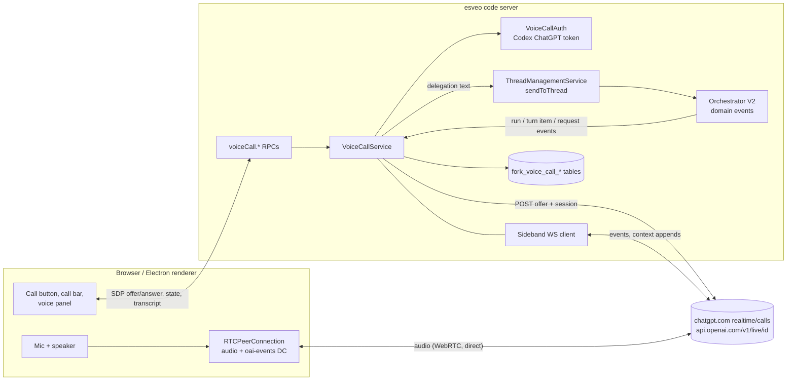

# Voice call (plan)

Status: implementation plan for the fork; phases 1 and 2 are built (see
[Deviations](#deviations-from-the-plan)). PAD's decisions of 2026-10-21/22/23
are the source; the v1 scope cut and the gpt-live-1.1 findings override older
notes. The plan is a guide, not a contract: where the code or a test showed a
better way, the build deviates and says so below. When the feature lands,
rewrite this page into the durable decisions and traps and drop the phase
list.

A voice call lets the user talk to esveo code. A realtime voice model
(OpenAI's GPT-Live, on the user's ChatGPT subscription) holds the
conversation, hands real work to the thread that is open on screen, and
reads the result back. It is separate from [voice input](voice-input.md),
which only dictates into the composer.

## Deviations from the plan

Phase 1:

- **Sideband socket.** Node's global `WebSocket` (undici) with the headers in
  its options, not the `ws` package; no new dependency.
- **`sendToThread` gained an optional `context`** (`// Fork:` lines in
  `ThreadManagementService.ts`), because it had no way to attach the
  `voice-call` record.
- **The reference href is `t3-context://v1/voice-call/<id>`**, the form
  `formatComposerContextReference` produces; the plan's form without `v1`
  does not parse.
- **The client identifies itself.** `subscribe` and `connect` carry a
  per-tab `clientId`. The server only connects a client that holds a
  subscription and ends the call when the owner's last subscription closes,
  which is the "dropped client" rule made concrete. A takeover is not a
  separate state: any `connect` (retry, takeover, fresh) closes the current
  segment, the status names the new owner, and the old tab closes its peer
  when it sees that it is no longer the owner.
- **`target` is a `ThreadId`**, not a `ThreadRef`: the call lives in one
  environment, so the environment part was redundant.
- **The segment lives inside `VoiceCallService`** for now; a separate
  `VoiceCallSegment.ts` waits until pause and expiry give it enough to own.
- **Auth: existing mode only, no refresh.** `VoiceCallAuth` reads the
  instance's `auth.json` (honouring `homePath`, shadow homes and
  `CODEX_HOME`), never writes it, and fails fast with "renew the Codex login"
  when the token expires within 5 minutes. Asking Codex to refresh and
  managed mode are left for a later phase; PAD's setup does not need them.
- **The subscription needs the operate scope** as well, since it keeps a
  billed session alive.
- **Transcripts** also go to the browser console (`[voice call] …` via
  `Effect.logInfo`).

Phase 2:

- **Questions and approvals are only announced** (PAD, 2026-10-23); see
  [Later](#later).
- **The gate and its queue live in `VoiceCallService`**, next to the segment
  state they read, not in a module of their own. A turn stops holding the gate
  30 s after it opened or after the user's last word, whichever is later, so a
  lost `turn.done` cannot block it but a long monologue still holds it.
- **No call tables yet.** The call and transcript tables wait for history in
  phase 4.
- **The three open protocol points were settled by rule, not by probing**;
  see [Protocol](#protocol).
- **The offer SDP is not trimmed.** ChatGPT rejects an offer without its
  final line break ("failed to unmarshal SDP: EOF"); the first real call
  from headless Chromium found it, and the fix went into phase 1.

## Goal and non-goals

Goal for v1:

- Start a call from the open thread on desktop (Electron) or web. Everything
  the voice delegates goes to the call's thread: it steers the active run
  or, when the user asks it to wait, queues behind it; an idle thread starts a
  normal turn either way.
- The backend is the thread's own provider and model. The voice is only the
  front end; no extra model hop sits between them.
- Results of that thread come back as speech. A new question or approval
  in the target thread is announced, but answered on screen only (see
  [Later](#later)).
- The call stays on the thread it started in while the user reads other
  threads, and moves only through "Call hierher holen" (PAD, 2026-10-30:
  following the screen sent requests to the wrong thread). It pauses
  itself when it is quiet because open time is billed, and wakes on speech
  or on a result.
- A voice panel with both transcripts and a card per delegated message, a
  global call bar, and past calls stored on the server.

Non-goals for v1:

- Routing: no "send this to thread 2", no new threads by voice, no
  promote-to-steer, no request header format. See [Later](#later).
- An overview of all threads for the voice. It sees only the call's thread.
- Mobile, multi-device handover, other voice vendors, sound effects.
- The classic Realtime protocol with function tools (works in the spike, but
  its quota pool and terms are unclear).

## Relation to upstream

Upstream PR [pingdotgg/t3code#14865](https://github.com/pingdotgg/t3code/pull/14865)
(open, "Codex voice conversations") shares the browser-audio / server-SDP split
and has desktop microphone permission code worth copying. It differs in the
parts that matter here:

- It runs the call through the Codex app-server (`thread/realtime/start`), so
  every handoff starts a Codex turn and only Codex threads can be the backend.
  We call the realtime endpoint directly and dispatch into any provider.
- Its conversation lives as long as one client stream and is not persisted.
  We pause, resume across views, and keep call history.

If upstream merges it, rebase onto its desktop permission and client-runtime
peer pieces instead of keeping our own copies.

## Architecture



- Audio never touches the esveo code socket. The client owns the mic, the
  speaker and the peer; audio flows between the client and OpenAI, so remote
  and tunnelled clients cost the same as local ones.
- The access token never reaches the client. The server POSTs the client's
  SDP offer and returns the answer.
- The server is the only writer of realtime events and reads them from the
  sideband. The client keeps the `oai-events` data channel open because the
  session needs it, but sends nothing on it and ignores what arrives, so no
  event is sent or handled twice.

## Protocol

Everything here comes from PAD's two local spikes (`/private/tmp/voice-spike/`,
not in the repo; 2026-10-22, codex-cli 0.163) and from Codex `main` @ `94350a9`. It is an
undocumented endpoint; re-check it when Codex changes its realtime code.

**Creating a call**

- `POST https://chatgpt.com/backend-api/codex/realtime/calls?intent=quicksilver&architecture=avas`
- Headers: `Authorization: Bearer <access token>`, `ChatGPT-Account-ID`,
  `originator: codex_cli_rs`, `openai-alpha: quicksilver=v2`,
  `User-Agent: codex_cli_rs/<version> …`, `Content-Type: application/json`.
- Body `{ sdp, session }` with `session`:
  - `model: "gpt-live-1-codex"`. The string selects nothing; the account
    decides the revision (1.1 on Plus and up). Never send `gpt-live-1.1-codex`.
  - `audio.output.voice`: one of the 25 v3 voices. An unknown voice ends the
    session with `error {code:"forbidden", message:"Voice session access denied."}`.
  - `delegation: { type: "client" }`. No `tools`: the v3 session rejects them
    and dies.
  - `instructions`: front-end prompt, language line, persona, recap (see
    [Prompts](#prompts)).
- Response: `201`, the SDP answer as text, `Location: …/rtc_<id>`. The call id
  is the last path segment. The POST took about 1.2 s.

**Sideband**

- `wss://api.openai.com/v1/live/{call_id}` with the same bearer and account
  headers. It carries the same event stream as the data channel and accepts
  our events. `session.update` with `delegation:{type:"client"}` works there
  and returns `session.updated`.
- Effect's `Socket.makeWebSocket` cannot send request headers, so the server
  adds `ws` as a direct dependency (it is already in the tree through
  `@effect/platform-node-shared`; `@types/ws` is in the catalog) or wraps it
  in a custom `Socket.WebSocketConstructor`.

**Events we read**

| Event                                                                                 | Use                                                |
| ------------------------------------------------------------------------------------- | -------------------------------------------------- |
| `session.started {session:{id, status, expires_at}}`                                  | segment is live; `expires_at` is about 2 h out     |
| `input_transcript.added {item.text, start_ms, end_ms}`                                | user transcript deltas, silence timer              |
| `output_transcript.added`                                                             | voice transcript deltas, silence timer             |
| `turn.created` / `turn.done {turn:{id, role, transcript}}`                            | speaking gate; persisted transcript on `turn.done` |
| `delegation.created {item:{id, content[].text}, handoff_id, user_bidi_turn_id}`       | the request to dispatch                            |
| `delegation.context.appended`, `session.context.appended`                             | delivery acks                                      |
| `session.usage.updated {usage.audio_duration_ms, usage_limit{status, reset_seconds}}` | quota, every 15 s                                  |
| `session.closed`, `error`                                                             | segment ended; `forbidden` means a bad voice       |

`session.input_audio.append` and `session.output_audio.delta` also arrive and
are dropped unread. No event names the model revision.

**Events we send (sideband only)**

| Event                                                                                                      | Use                                              |
| ---------------------------------------------------------------------------------------------------------- | ------------------------------------------------ |
| `delegation.context.append {delegation_item_id, channel:"speakable", content:[{type:"input_text", text}]}` | the answer to one delegation                     |
| `session.context.append {channel:"speakable", content:[…]}`                                                | unprompted events: results, questions, approvals |
| `session.close`                                                                                            | pause, hang-up, expiry, failed connect           |

Appends are limited to 500 tokens each. Like Codex, cap a result at about
1,000 tokens (`REALTIME_ASSISTANT_OUTPUT_TOKEN_BUDGET`) and send it in
500-byte chunks.

**Proven:** a delegation held for 180 s is still spoken when answered; an
unsolicited `session.context.append` is spoken; the data channel alone works
end to end. **Settled by rule in phase 2** instead of by probing, because each
probe costs voice quota and the rule is safe either way:

- _Holds over 180 s:_ not relied on. An answer to a delegation older than
  180 s, or from a closed segment, goes out as `session.context.append`
  ("Result of the earlier request "…". From <title>: …"), the proven path.
- _Several open delegations:_ only the newest open delegation of a run gets
  the answer; the older ones are marked superseded and stay unanswered in
  the session.
- _Barge-in during injected speech:_ left to the model. The speaking gate
  only decides when an injection starts.

**Not tested:** a non-spoken context channel (`session.thinking.append`,
`initial_items`).

## Server modules

Everything new lives in `apps/server/src/voiceCall/` (the name avoids the
existing `voiceInput/` dictation module), with the contract in
`packages/contracts/src/voiceCall.ts`.

- **`VoiceCallAuth.ts`** returns `{ accessToken, accountId }` for the Codex
  provider instance (v1: the default `codex` instance).
  - _Existing mode_ (PAD's setup: no `providerInstances.codex`, so the default
    mode, with `~/.codex/auth.json`): read `<CODEX_HOME>/auth.json` on every
    mint (resolve the home as
    [`threadRoots.ts`](../../apps/server/src/forkInstructions/threadRoots.ts)
    does). `tokens.access_token` and `tokens.account_id` are what the spike
    used. **Never write the file**: the Codex CLI owns it and a concurrent
    write would race its refresh. If the JWT `exp` is near, ask Codex to
    refresh (to verify in phase 1: the app-server account read with token
    refresh); if that is not possible, fail with "renew the Codex login".
  - _Managed mode_: `makeCodexChatGptAuth(...).access` in
    [`CodexChatGptAuth.ts`](../../apps/server/src/provider/CodexChatGptAuth.ts)
    already refreshes under the shared session lock. The account id is not a
    field there; read it from the id token's ChatGPT claim. Its token is
    scoped to `api.openai.com/v1` with `chatgpt.tokens.use.direct`; verify
    that chatgpt.com accepts it.
  - An API-key Codex login cannot make this call; report it as unavailable.
- **`RealtimeCallClient.ts`**: the POST (via `HttpClient`, as in
  [`cliproxyApi.ts`](../../apps/server/src/usage/cliproxyApi.ts)), the sideband
  socket, typed decode of the events above, `send`, `close`. No call logic.
- **`VoiceCallSegment.ts`**: one realtime session. Owns the speaking gate,
  the injection queue, the silence timer and usage tracking.
- **`VoiceCallService.ts`**: one call per environment. Owns the target
  thread, open delegations, the segment lifecycle (connect, pause, resume,
  expiry, retry), persistence and the change stream. A second client that
  connects takes the call over; the first gets a `takenOver` state and closes
  its peer.
- **`VoiceCallReadBack.ts`**: subscribes to `streamDomainEvents` (pattern of
  [`DelegatedTaskQuestionReactor.ts`](../../apps/server/src/orchestration-v2/DelegatedTaskQuestionReactor.ts)
  with `forkParked`) and turns run, turn-item and runtime-request events into
  answers and injections.
- **`voiceCallPrompt.ts`**: front-end instructions, backend hint, recap.

**RPCs** (`VOICE_CALL_WS_METHODS`, all `AuthOrchestrationOperateScope`):

```ts
voiceCall.subscribe: {} -> stream VoiceCallEvent   // snapshot, then deltas
voiceCall.connect:   { offerSdp, target: ThreadRef | null, retryOf?: SegmentId }
                     -> { answerSdp, segmentId }    // start, resume and retry
voiceCall.setTarget: { target: ThreadRef | null } -> void
voiceCall.pause:     {} -> void                     // manual "lazy hang-up"
voiceCall.hangUp:    {} -> void
voiceCall.listCalls / voiceCall.readCall            // history, phase 4
```

The subscription sends deltas, not full snapshots, so a long call does not
resend its whole transcript on every word. When the owning client's
subscription ends while a segment is live, the server closes the segment
at once, so a dropped client cannot leave a billed session open.

Wiring follows the existing fork RPCs (commit `d1de6178f0` lists the files):
`forkWsRpc.ts` (`ForkWsRpcGroup`, `FORK_WS_RPC_TAGS`), contracts `index.ts`,
`forkHandlers` in `ws.ts`, `RPC_REQUIRED_SCOPES` in
`auth/RpcAuthorization.ts`, `observability/forkRpcAggregates.ts`, the layer in
`server.ts`, and **`EnvironmentSubscriptionRpcTag` in
`packages/client-runtime/src/rpc/client.ts`**, without which the client types
the stream as unary. [`ForkNotes.ts`](../../apps/server/src/forkNotes/ForkNotes.ts)
is the template for the service, its table and its PubSub stream.

### The steer path

On `delegation.created`:

1. No target (a call cannot start on a draft, so this means the target thread
   is gone or `setTarget(null)` was called) or an archived thread:
   answer the delegation at once with one sentence saying so.
2. Otherwise call `ThreadManagementService.sendToThread` with `mode: "auto"`:
   it steers a steerable run and otherwise starts one. A delegation carries
   only text, so the voice asks for queueing by beginning it with the marker
   `[queue]`, which the server strips and turns into `mode: "queue"`.
   Interruptions the server forwards itself always use `auto`. Ids follow
   [`ScheduledTaskService`](../../apps/server/src/scheduledTasks/ScheduledTaskService.ts):
   `CommandId` `voice-call:<callId>:<delegationItemId>`, `MessageId`
   `voice-call-message:<callId>:<delegationItemId>`, so a retried event cannot
   dispatch twice. `createdBy: "user"`, `creationSource: "server"`.
3. Record the delegation `{ delegationItemId, segmentId, threadId, messageId,
   runId, status: open }` and push a card to the panel.

The voice has already said a filler ("On it.") and stays conversational; the
answer follows when the run settles. A dispatch failure is answered at once
with a short reason.

**Marking the message as voice.** Do not add `"voice"` to `creationSource`;
it is an upstream `Schema.Literals` and every sync would conflict. Use a
context record instead: the text starts with a reference
`[Voice](t3-context://voice-call/<id>)` and `context.records` holds
`{ kind: "voice-call", payload: { hint } }`. `UnknownContextRecord` accepts
the custom kind, and
[`projectComposerContextForProvider`](../../packages/shared/src/composerContextReferences.ts)
puts the payload into the `<t3_context>` envelope of the provider prompt for
every provider. The reference renders as a chip in the user bubble, which
doubles as the "via voice" badge; check how the web renders an unknown kind
and add a small fork chip if it looks wrong.

## Read-back

- **Answer to a delegation.** When a run linked to open delegations reaches a
  terminal status, take its last assistant message, cap it at about 1,000
  tokens (cut at a sentence; replace code blocks with "code is in the
  thread"), prefix the thread title, and send it with
  `delegation.context.append` on the newest open delegation of that run.
  Older open delegations of the same run (steered twice) are marked
  superseded and get nothing. A failed or interrupted run answers with one
  sentence and the error. A queued delegation holds its own run's id from the
  start, so the run in front of it does not answer it; it usually settles past
  the 180 s window and then goes out unprompted.
- **Unprompted events** in the thread that is the target _when the event
  fires_: a run that settles with no open delegation, a new user-input
  question, a new approval request. They go out as `session.context.append`
  ("Update from <title>: …"). A run that answered a delegation never also
  triggers an unprompted update.
- **Speaking gate.** Injections wait in a queue until no user turn is open
  (every `turn.created role:user` has its `turn.done`), no assistant turn is
  open, and the user's last word or turn end is at least 1.5 s old. Answers to
  delegations pass the same gate. Codex has no such gate and relies on the
  model; we add it because PAD wants events held until he is done talking.
- **Segment gone.** A delegation id belongs to its segment. If that segment
  has closed (pause, expiry), the answer goes out as `session.context.append`
  on the next segment. While the call is auto-paused, a result wakes it (see
  [Pause](#pause-resume-expiry-and-quota)); while manually paused, results
  queue and are spoken after resume.
- **A new call starts empty (PAD, 2026-10-30).** Nothing of an ended call
  reaches the next one: not its recap, not its queued items, not the answers
  to its open delegations, since the next call may be about another thread.
  The answers stay in the thread. A server restart ends the call too, so
  delegations are not persisted and `fork_voice_call_delegations` is unused.
- **Built in phase 2:** the gate and its queue live in `VoiceCallService`
  (the segment state is there); `VoiceCallReadBack.ts` follows
  `DelegatedTaskQuestionReactor`. Queued items older than an hour are dropped.
  A turn with no user word for 30 s no longer holds the gate, so a lost
  `turn.done` cannot block it.

**Questions and approvals** are not answered by voice in v1 (PAD,
2026-10-23). A new pending request in the target thread may be announced as
an unprompted update; the front-end prompt tells the voice to send the user
to the screen. Anything the user says in reply is a normal steer.

## Prompts

`voiceCallPrompt.ts` builds three texts; `prompt.py` in Bloo's `bloo-voice`
plugin is the reference for tone and for the doze notes.

- **Front-end instructions** (POST `instructions`): you are the voice of
  esveo code talking to the user; every delegation becomes a visible message
  in the thread, so delegate only when the user clearly wants the agent to act
  or to find something out, and answer questions about the call or the app
  yourself; a delegation passes along the user's own words, not rephrased (the
  model does this anyway; Codex's `background_agent` tool demands it), so the
  context comes from `payload.transcript`, the turns since the last delegation,
  mirroring Codex's `<transcript_delta>`; after delegating say only that it was passed on, never what the agent will do, and stay responsive while it runs; read results
  back short and without Markdown; when told about a question or approval,
  tell the user it waits on screen; do not invent results. Plus the language line (`auto`: answer in the user's
  language; `de`: always German, from the first sentence), the persona text,
  the current target thread's title, the time, and on resume a recap. A move
  during a live segment is sent as speakable context, the only channel known
  to work, so the voice says it aloud; a paused call learns it from the next
  segment's instructions.
- **Backend hint** (the `voice-call` context record), modelled on Codex's
  `realtime_start.md`: this message comes from a live voice call, a transcript
  of speech, so it may contain recognition errors; `transcript` explains short
  replies; your
  final answer is read aloud by that assistant; keep it short and
  action-oriented; leave long output, code and lists in the thread and say
  that they are there.
- **Recap** for a new segment: the last 8 transcript turns (Bloo's
  `RECAP_TURNS`) and any open delegations, as part of `instructions`. That is
  the one carry-over mechanism we control and know works; `initial_items` and
  a silent context channel are unverified.

## Client modules

New folder `apps/web/src/components/voiceCall/`. Mobile is out of scope, so
the controller stays in the web app instead of `packages/client-runtime`.

- **`voiceCallState.ts`**: atoms built with
  `createEnvironmentRpcSubscriptionAtomFamily` and `createEnvironmentRpcCommand`,
  copied from [`forkNotesState.ts`](../../apps/web/src/components/forkNotes/forkNotesState.ts).
- **`voiceCallPeer.ts`**: `getUserMedia`, the peer, the `oai-events` channel,
  remote audio playback. Needs a secure context, like dictation.
- **`useVoiceCallController.ts`**: connect, retry, pause and wake (see
  below), takeover, hang-up.
- **The target**: set by `connect` when a call starts, and by `setTarget` only
  from "Call hierher holen", shown in every composer (each split pane on its
  own) whose thread is not the target. Resuming or taking over from another
  thread resends the current target, because `connect` replaces it.
- **`VoiceCallButton.tsx`**: start, and stop while live. Mounted with one
  `// Fork:` line in the `panelToggleControls` span of `ChatView.tsx`, next to
  `ThreadFindHeaderButton`. Also a command palette action.
- **`VoiceCallBar.tsx`**: a small fixed pill on every route: state
  (connecting, live, paused, auto-paused, error), minutes, quota warning,
  pause/resume, hang up, open panel. Mounted in the coordinator row of
  `RootRouteView` in `routes/__root.tsx`. Popout windows do not get it.
- **`VoiceCallPanel.tsx`**: a `voice-call` right-panel surface registered
  through `useForkRightPanelSurfaces` (model: the Instructions tab, commit
  `f0373c7ffc`). The right-panel store is per thread, so the panel opens on
  the target thread and follows to the new thread when the call moves while
  it is open. The content reads the call store, so it is the same
  everywhere. It shows the user and voice transcripts and a card per
  delegation (thread, text, status, answer excerpt), plus the past calls list.
- **`voiceCallJump.ts`**: clicking a card navigates to
  `/$environmentId/$threadId` with the message id in history state; a small
  hook mounted in `MessagesTimeline` finds the row by `data-message-id`,
  pages in earlier history like `useAssistantCitationTarget`, and calls
  `scrollToIndex`. Citations stay as they are; they only target assistant
  messages.
- **`VoiceCallSettingRows.tsx`**: see [Settings](#settings).

**Desktop.** Dictation already records in the desktop app (see "Dictation" in
`docs/fork/setup.md`), so check first whether WebRTC needs more. If it does,
copy `MainWindowPermissions.ts` from #14865 into a fork file mounted in
`DesktopWindow.ts`, and add `NSMicrophoneUsageDescription` in all three
places: `scripts/build-desktop-artifact.ts` (`extendInfo`),
`apps/desktop/scripts/electron-launcher.mjs`, and `scripts/fork-app.sh`,
which re-signs ad hoc and so needs its own plist patch.

## Persistence

Plain fork tables, created in `ensureForkSchema`
([`forkSchema.ts`](../../apps/server/src/threadOrchestration/forkSchema.ts)),
not orchestration events: a call is not thread state.

- `fork_voice_calls`: id, started/ended at, state, voice, last target,
  total audio ms.
- `fork_voice_call_segments`: id, call id, realtime call id, started/ended
  at, end reason (pause, auto-pause, expiry, retry, hang-up, error),
  audio ms, expires at.
- `fork_voice_call_entries`: id, call id, segment id, sequence, kind
  (`user`, `voice`, `delegation`, `injection`), text, thread id, message id,
  run id, delegation status, timestamps.

Transcript turns are written on `turn.done`, never per delta. Live deltas only
go over the stream.

Phase 2 built only `fork_voice_call_delegations` (delegation id, call id,
status, the delegation as JSON); the other tables come with history in
phase 4.

The "Voice call started/ended" lines in the chat come from
`voice-call-thread-spans.json` in the state dir, one span per segment, so a
pause or a move also ends and starts a line. They are merged into the timeline
on the client and never reach the agent.

## Settings

`voiceCallEnabled` is the feature's global switch, off by default. Off hides the
button, the lanes and the chat lines, refuses a connect, ends a running call and
takes `voice_say` out of `tools/list` live (`McpOrchestrationTools.ts`).

There is no feature flag (PAD, 2026-10-30): the button sits next to the send
button in the composer and shows whenever Codex has a ChatGPT login. It stays
hidden without one or with an API key. An expired login keeps the button,
disabled, with the renewal hint. While a call runs, a timeline with lanes for
the user, the voice and the thread shows above the composer of the thread it
talks to. Of the settings below, only the voice has a row so far.

## `voice_say`

The agent of the thread on the call can speak while it works (MCP tool
`voice_say`), and the tool returns once the voice said it. The next voice
`turn.done` after the injection counts as said, since the speaking gate only
injects with no turn open. If the user talks meanwhile, their finished turn is
steered into the thread first and the tool returns `interrupted` only after
that, so the agent cannot carry on in between. The voice may delegate the same
words on its own: if that comes first it is the steer, if it comes later it
gets an answer and does not reach the thread. A completed run that used
`voice_say` is not read back.

Server settings, because the server builds the session. They follow the fork
pattern in `packages/contracts/src/settings.ts` (commit `57befeadb1` has the
touch list): a field with a decoding default plus the matching optional key in
`ServerSettingsPatch`.

- `voiceCallVoice`: one of the 25 v3 voices (a constant list in the contract:
  juniper, maple, spruce, ember, vale, breeze, arbor, sol, cove, aube,
  bubbie, haetsal, hanul, himari, leher, miko, neer, porto, rindo, rio,
  rivage, selva, sonna, tinta, viola). Default `miko` (PAD, 2026-10-23).
  Only the list is offered, because an off-list voice kills the session.
- `voiceCallLanguage: "auto" | "de"`, default `"auto"`.
- `voiceCallPersona: string`, default empty, capped in length.

Rows sit in Settings next to `VoiceInputSettingRow`, use
`esveoSearchableSetting`, and their search items set `fork: true`. The
subscription reports availability, so the UI can hide the button or explain why
a call cannot start: no Codex instance, Codex logged in with an API key, login
expired.

## Pause, resume, expiry and quota

`audio_duration_ms` is wall-clock session time, so an idle open session uses
quota. Pausing therefore closes the realtime session; the call itself stays.

- **Auto-pause.** The server pauses after 30 s without any transcript delta
  in either direction, when no turn is open and the voice is not speaking.
  An open delegation does not hold the session open; its result wakes it.
  The server sends `session.close`, persists the segment, and tells the
  client, which closes its peer but keeps the mic.
- **Wake on speech.** While auto-paused the client runs a level gate (Bloo:
  peak about 500/32767 for 300 ms of speech) and keeps a 12 s ring buffer.
  On speech it connects a new segment and replays the buffer first, so the
  model hears the whole sentence that woke it. Bloo drops a replay shorter
  than 1.5 s, because the model makes things up from a cough. **Trap:**
  Discord sends no packets in silence, so Bloo's backlog drains by itself; a
  browser mic produces frames all the time, so a replayed buffer never
  catches up. The input track (an `AudioWorklet` into a
  `MediaStreamAudioDestinationNode`) must skip quiet frames while a backlog
  remains.
- **Wake on a result.** The server asks the owning client to connect; the
  queued answer is spoken once the new segment has started. With no client
  subscribed, it stays queued.
- **Manual pause ("lazy hang-up").** Closes the session and releases the mic.
  No auto-wake. Results queue and are spoken after resume, and the new
  session's instructions carry the last 8 turns, because it knows nothing of
  the call. The diagram's clock stands still meanwhile, so waves and sections
  continue without a gap. A running `voice_say` ends as `call_ended`.
- **Expiry.** `expires_at` is about 2 h. From 5 minutes before, the next quiet
  moment (the speaking gate) triggers a close and an immediate new segment
  with a recap; at 1 minute before it is forced.
- **Retry.** The data channel sometimes never opens (one of 17 v3 calls in
  the 1.1 spike; worse on the classic route). If the peer is not connected
  and the channel not open within 15 s, or the sideband fails to connect, the
  client calls `connect` with `retryOf`; the server closes the old call and
  mints a new one. Three attempts, then an error state. Each attempt is
  logged.
- **Quota.** The Usage page shows esveo code's own count of connected segment
  time per server (`VoiceCallUsage.ts`), against the plan's rolling 24-hour
  allowance from OpenAI's help center. It is an estimate: ChatGPT-app use is
  invisible, and nothing confirms these sessions draw on that allowance, so it
  must never read as OpenAI's figure. It lives in a JSON file under the state
  directory, not a SQL table, because a migration would conflict with upstream's
  and history is not needed. When `usage_limit.status` is not null, show it and
  `reset_seconds` as a warning.

## Phases

Each phase is one reviewable PR on the feature branch.

1. **Server call and steer path.** Contract and RPC wiring, `VoiceCallAuth`
   (existing mode first), `RealtimeCallClient` with the sideband,
   `VoiceCallService` with `connect` / `setTarget` / `hangUp` / `subscribe`,
   the steer path with the voice context record, the front-end prompt,
   voice/language/persona settings (no rows yet), connect retry. A bare
   `VoiceCallButton` (start and stop, transcript in the browser console) is the end-to-end check; no panel, bar or pause yet.
   Desktop mic only if the check shows it is needed.
2. **Read-back.** `VoiceCallReadBack`, delegation answers with cap and
   chunking, unprompted events for the target, the speaking gate. Questions and approvals are only
   announced. Settles the untested protocol points listed above.
3. **Pause, resume, expiry, quota.** Auto-pause, client level gate and
   replay buffer, wake on result, manual pause, recap, 2 h rollover, usage
   tracking.
4. **UI.** Voice panel with transcripts and cards, jump to message, call
   bar, command palette action, settings rows, history tables and
   `listCalls` / `readCall`. Rewrite this page into the durable internals
   doc, add a user doc section and the changelog entry.

## Testing

- Unit tests with a fake `RealtimeCallClient` that replays recorded spike
  event sequences (`/private/tmp/voice-spike/logs/a1_v3_dc.txt`,
  `c1_v3_ws_hold60.txt`, `l11_v_marin.txt`): delegation to dispatch, ids
  stable on duplicates, no-target and archived answers, auth failures.
- Read-back with the orchestrator test harness: drain
  `OrchestrationEffectWorkerV2.drain` or await the persisted run event, never
  sleep. Cover steer twice then one answer, unprompted versus delegated
  dedupe, the speaking gate holding an injection until `turn.done`, segment
  gone.
- Pause logic with a test clock: silence timer, expiry window, retry limit.
- `VoiceCallAuth`: existing mode never writes `auth.json`; expired token
  path; managed mode account id from the id token.
- Manual, per phase: a real call on PAD's login in a worktree dev server
  seeded with `vp run migrate-dev-db`, never against `~/.t3`. The spike
  scripts (`t_a_direct.py`, `t_live11.py`, `cleanup_calls.py`) stay the
  reference for protocol questions; close every test call.
- Run only the touched specs and a scoped typecheck, per `FORK.md`.

## Risks

- **Undocumented endpoint.** `/backend-api/codex/realtime/calls` can change
  or close at any time. We send `originator: codex_cli_rs` and a Codex user
  agent, which is a gray area under OpenAI's terms for a third-party app on a
  subscription login. `X-OAI-Attestation` is optional today and could become
  mandatory, which would end this path. Keep the code behind
  `RealtimeCallClient` so a switch to the metered `gpt-live-1` API (API key,
  per minute) touches one module.
- **No model signal.** No event reports the model revision. 1.1 is inferred
  from the account plan and from 1.1-only voices rendering. If voices and
  model ever decouple, we cannot tell.
- **Idle billing.** Open time counts, whether anyone talks or not. A bug in
  pause, takeover or disconnect handling burns the user's voice allowance;
  the server must close a segment whenever its owning client goes away.
- **Token handling.** Existing mode depends on the Codex CLI keeping
  `auth.json` fresh. The token must never be logged or sent to the client.
- **Unclear quota pool.** Whether voice minutes draw on the ChatGPT voice
  allowance or the Codex limits is unknown.
- **Recognition errors.** Without routing, every delegation steers the call's
  thread. A misheard request lands there, whichever thread PAD is looking at.
- **Untested protocol points** listed under [Protocol](#protocol).

## Later

- Answering questions and approvals by voice. The rule PAD postponed on
  2026-10-23: while the target thread has exactly one pending `user_input`
  request, the next delegation is its free-text answer
  (`runtime-request.respond` with `answers`, the path MCP
  `t3_pending_request_respond` uses), not a steer; a delegation of exactly
  `approve` or `decline` while one approval is pending answers it with
  `decision: accept|decline`; with more than one pending request, announce
  how many and point to the screen. The alternative is a request header
  format (see routing).
- Routing: send to another thread (and switch the UI there), open a new
  thread with project and model inference, promote the last queued message
  to a steer. Options: a fixed request header the
  voice writes and the server parses, a cheap router model as fallback, or
  the classic Realtime protocol with real function tools once its quota and
  terms are clear.
- An overview of all active and recent threads for the voice.
- A silent context channel for target-change notes, once one is verified, so
  a move need not be spoken.
- Mobile (react-native-webrtc, as in #14865).
- A choice of Codex instance when there are several.
- A health check that starts a 1.1-only voice to confirm the revision.
- Keybinding for start/stop and mute.
